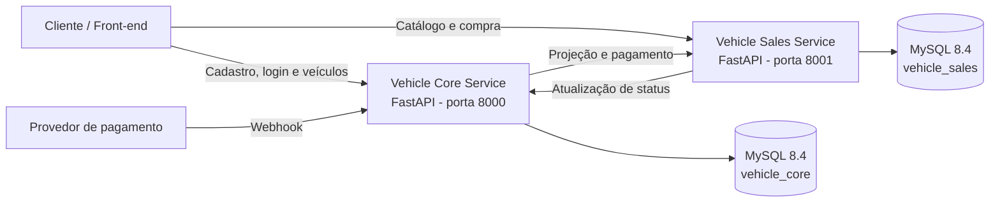
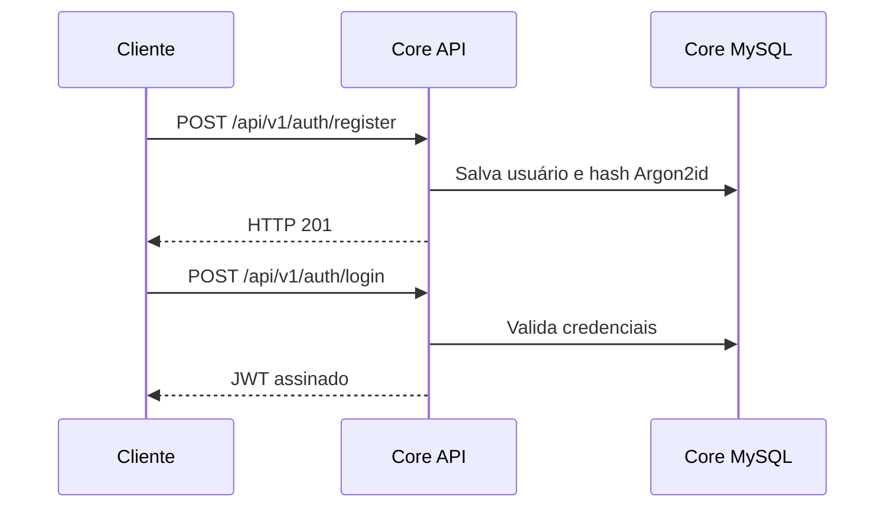
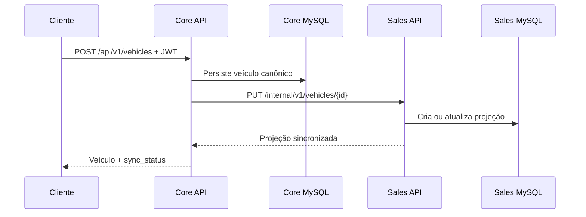
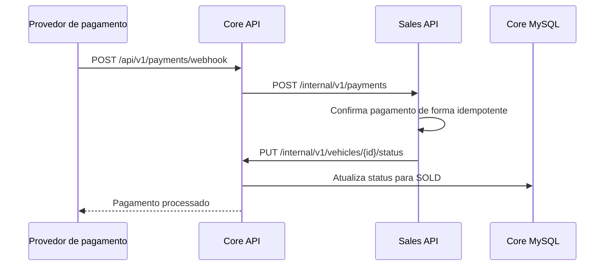
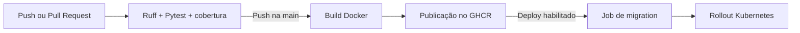

# Vehicle Core Service

[](https://github.com/Hackaton-Fiap-Matheus-Pereira/vehicle-core-service/actions/workflows/ci-cd.yml)

Serviço principal da plataforma de revenda de veículos desenvolvida para o **Tech Challenge SOAT - Fase 4**.

O Core mantém o cadastro canônico dos veículos, registra usuários, autentica com JWT e recebe o webhook externo de pagamento. As listagens e compras pertencem ao [Vehicle Sales Service](https://github.com/Hackaton-Fiap-Matheus-Pereira/vehicle-sales-service), que possui banco de dados próprio.

## 🎯 Objetivo da solução

Disponibilizar o núcleo administrativo e de identidade de uma plataforma de venda de veículos, mantendo os domínios Core e Sales desacoplados por APIs HTTP.

O fluxo principal contempla:

1. cadastro prévio do usuário;
2. autenticação e emissão de JWT;
3. cadastro e edição de veículos;
4. sincronização do catálogo com o serviço de vendas;
5. criação da compra no Sales;
6. recebimento do webhook de pagamento;
7. atualização dos estados `AVAILABLE`, `RESERVED` e `SOLD`.

## ✅ Requisitos atendidos

| Requisito | Implementação |
|---|---|
| Cadastrar usuário | `POST /api/v1/auth/register` |
| Autenticar usuário | `POST /api/v1/auth/login`, com emissão de JWT |
| Cadastrar veículo | `POST /api/v1/vehicles` |
| Editar veículo | `PATCH /api/v1/vehicles/{vehicle_id}` |
| Consultar veículo | `GET /api/v1/vehicles/{vehicle_id}` |
| Receber confirmação de pagamento | `POST /api/v1/payments/webhook` |
| Proteger credenciais | Argon2id, JWT e segredos em variáveis de ambiente |
| Separar os dados por domínio | Banco MySQL exclusivo do Core |
| Integrar microsserviços | HTTP com `X-Service-Token` e projeção versionada |
| Automatizar qualidade e entrega | Ruff, Pytest, GitHub Actions, GHCR e deploy Kubernetes opcional |

## 🏗️ Arquitetura da solução



| Componente | Porta local | Responsabilidade |
|---|---:|---|
| Vehicle Core Service | `8000` | Usuários, JWT, cadastro canônico e webhook |
| Vehicle Sales Service | `8001` | Catálogo, reserva, compra e histórico de vendas |
| Core MySQL | Interna | Usuários e veículos canônicos |
| Sales MySQL | Interna | Projeções, compras e eventos de pagamento |

### Separação dos dados

Cada microsserviço possui sua própria instância MySQL e não acessa diretamente o banco do outro. A integração acontece exclusivamente por HTTP com o header `X-Service-Token`.

O Core não expõe uma listagem geral de veículos. As listas de disponíveis e vendidos são responsabilidade exclusiva do Sales, conforme a separação de domínios do desafio.

## 🔁 Fluxos principais

### Cadastro e autenticação



### Cadastro e sincronização do veículo



### Confirmação do pagamento



## 🗄️ Persistência de dados

O Core utiliza **MySQL 8.4**, SQLAlchemy 2 assíncrono e Alembic.

### `users`

- identificador UUID;
- nome completo;
- e-mail único;
- senha armazenada somente como hash Argon2id;
- indicador de usuário ativo;
- datas de criação e atualização.

### `vehicles`

- marca, modelo, ano, cor e preço;
- status `AVAILABLE`, `RESERVED` ou `SOLD`;
- estado de sincronização `PENDING`, `SYNCED` ou `FAILED`;
- `source_version` para controle de versões;
- usuário responsável pelo cadastro;
- datas de criação e atualização.

As migrations são executadas com Alembic antes da inicialização das APIs no Docker Compose.

## 🔐 Segurança e regras de negócio

- senhas protegidas com Argon2id;
- autenticação stateless com JWT;
- expiração configurável do token;
- APIs internas protegidas por `X-Service-Token`;
- webhook protegido por `X-Webhook-Secret`;
- comparação segura dos segredos;
- validação de entrada com Pydantic;
- preço positivo e ano dentro dos limites aceitos;
- controle de concorrência no serviço de vendas;
- segredos fornecidos por variáveis de ambiente;
- `.env` excluído do versionamento;
- containers executados como usuário não-root.

## 🚀 Tecnologias utilizadas

- Python 3.12;
- FastAPI;
- SQLAlchemy 2 assíncrono;
- MySQL 8.4;
- Alembic;
- Pydantic v2;
- JWT com PyJWT;
- Argon2;
- HTTPX;
- Docker e Docker Compose;
- Kubernetes e Kind;
- Terraform;
- Pytest e Ruff;
- GitHub Actions;
- GitHub Container Registry.

## 📋 Pré-requisitos

Para executar a plataforma completa:

- Docker Desktop;
- Docker Compose v2;
- Git.

O Python local é opcional quando a execução é feita com Docker.

## 🛠️ Execução local da plataforma

### 1. Clonar os dois repositórios como diretórios irmãos

```bash
git clone https://github.com/Hackaton-Fiap-Matheus-Pereira/vehicle-core-service.git
git clone https://github.com/Hackaton-Fiap-Matheus-Pereira/vehicle-sales-service.git
cd vehicle-core-service
```

O `docker-compose.yml` do Core utiliza o diretório irmão `../vehicle-sales-service`.

### 2. Configurar o ambiente

Linux ou macOS:

```bash
cp compose.env.example .env
```

Windows PowerShell:

```powershell
Copy-Item compose.env.example .env
```

Substitua todos os valores `CHANGE_ME` do `.env`. O arquivo contém as credenciais dos dois bancos e os segredos de integração.

### 3. Subir a plataforma

```bash
docker compose up --build --wait
```

### 4. Verificar os containers

```bash
docker compose ps -a
```

Resultado esperado:

- `core-db` e `sales-db` saudáveis;
- `core-migrations` e `sales-migrations` finalizadas com código `0`;
- `vehicle-core-service` e `vehicle-sales-service` saudáveis.

### 5. Encerrar sem apagar os dados

```bash
docker compose down
```

> Use `docker compose down -v` somente quando desejar apagar permanentemente os volumes e todos os dados locais.

## 🌐 URLs da aplicação

| Serviço | URL |
|---|---|
| Core Swagger | http://localhost:8000/docs |
| Core OpenAPI | http://localhost:8000/openapi.json |
| Core Liveness | http://localhost:8000/health/live |
| Core Readiness | http://localhost:8000/health/ready |
| Sales Swagger | http://localhost:8001/docs |
| Sales OpenAPI | http://localhost:8001/openapi.json |
| Sales Liveness | http://localhost:8001/health/live |
| Sales Readiness | http://localhost:8001/health/ready |

## 📚 Endpoints do Core

### API pública

| Método | Endpoint | Proteção | Descrição |
|---|---|---|---|
| `POST` | `/api/v1/auth/register` | Pública | Cadastra um usuário |
| `POST` | `/api/v1/auth/login` | Pública | Autentica e retorna um JWT |
| `POST` | `/api/v1/vehicles` | JWT | Cadastra e sincroniza um veículo |
| `GET` | `/api/v1/vehicles/{vehicle_id}` | JWT | Consulta um veículo canônico |
| `PATCH` | `/api/v1/vehicles/{vehicle_id}` | JWT | Edita os dados do veículo |
| `POST` | `/api/v1/vehicles/{vehicle_id}/sync/retry` | JWT | Repete uma sincronização pendente ou falha |
| `POST` | `/api/v1/payments/webhook` | `X-Webhook-Secret` | Recebe a decisão do pagamento |
| `GET` | `/health/live` | Pública | Verifica o processo |
| `GET` | `/health/ready` | Pública | Verifica o banco |

### API interna

| Método | Endpoint | Proteção | Descrição |
|---|---|---|---|
| `PUT` | `/internal/v1/vehicles/{vehicle_id}/status` | `X-Service-Token` | Recebe do Sales uma mudança de status |

## 🧪 Demonstração ponta a ponta

Com os containers saudáveis, execute:

```powershell
.\scripts\e2e-demo.ps1
```

O script valida automaticamente:

1. readiness das duas APIs;
2. cadastro do usuário;
3. login sem expor o JWT;
4. cadastro e sincronização do veículo;
5. listagem dos disponíveis por preço crescente;
6. criação idempotente da compra;
7. confirmação pelo webhook;
8. presença do veículo nos vendidos e remoção dos disponíveis.

Resultado esperado:

```text
Fluxo ponta a ponta concluído com sucesso.
```

## 🧪 Testes automatizados

```bash
python -m venv .venv
python -m pip install --upgrade pip "-e" ".[dev]"
ruff check .
ruff format --check .
pytest
```

Os testes usam SQLite assíncrono em memória e doubles das integrações externas. A execução falha se a cobertura total ficar abaixo de 80%.

## 🔄 Pipeline CI/CD

O workflow `.github/workflows/ci-cd.yml` é executado em Pull Requests e pushes na `main`.



### Pull Request

- configura Python 3.12;
- instala as dependências;
- executa Ruff;
- executa Pytest com cobertura mínima de 80%.

### Push ou merge na `main`

- constrói a imagem Docker;
- publica as tags `latest` e SHA do commit no GHCR;
- utiliza o `GITHUB_TOKEN` fornecido automaticamente pelo GitHub.

Imagem publicada:

```text
ghcr.io/hackaton-fiap-matheus-pereira/vehicle-core-service
```

### Deploy Kubernetes opcional

O deploy é executado quando o repositório possui:

- variável `ENABLE_K8S_DEPLOY=true`;
- secret `KUBE_CONFIG_B64`;
- variável opcional `KUBE_NAMESPACE`, com padrão `vehicle-core`.

Sem essas configurações, qualidade, testes, build e publicação no GHCR continuam funcionando; somente o job de deploy fica ignorado.

## ☸️ Kubernetes e Kind

A infraestrutura completa está em `infra/` e inclui:

- namespaces separados;
- dois StatefulSets MySQL com volumes persistentes;
- Deployments das APIs;
- Jobs Alembic;
- Services internos;
- probes de liveness e readiness;
- NetworkPolicies entre os domínios;
- HPA para o Sales;
- configuração de cluster Kind.

Renderização local dos manifests:

```bash
kubectl kustomize infra/kubernetes
```

## 🏭 Terraform

A pasta `infra/terraform/` declara os recursos Kubernetes da solução como código.

```bash
cd infra/terraform
cp terraform.tfvars.example terraform.tfvars
terraform init
terraform plan
terraform apply
```

O arquivo `terraform.tfvars` contém valores locais e não deve ser enviado ao GitHub.

## 📊 Logs e diagnóstico

```bash
docker compose logs -f
docker compose logs -f vehicle-core-service
docker compose logs -f vehicle-sales-service
docker compose logs core-migrations sales-migrations
```

Estado dos recursos Kubernetes:

```bash
kubectl get pods,deploy,sts,svc,pvc,hpa -A
```

## ⚠️ Limitações do MVP

- não existe interface front-end;
- o ambiente local utiliza HTTP sem TLS;
- o JWT utiliza segredo simétrico compartilhado;
- não há recuperação de senha ou confirmação de e-mail;
- a integração entre os serviços é síncrona por HTTP;
- não há observabilidade avançada com métricas e traces;
- o deploy permanente exige um cluster acessível ao GitHub Actions.

## 🔮 Possíveis evoluções

- JWT assimétrico com RS256 e JWKS;
- mensageria para sincronização assíncrona;
- padrão outbox para eventos de integração;
- rotação e gerenciamento externo de secrets;
- rate limiting;
- OpenTelemetry, Prometheus e Grafana;
- ingress controller e HTTPS;
- testes de carga e concorrência;
- interface web para compradores e administradores.

## 👥 Organização do repositório

```text
vehicle-core-service/
├── app/                       # API, domínio, segurança e integrações
├── alembic/                   # Migrations do banco Core
├── tests/                     # Testes automatizados
├── scripts/                   # Demonstração ponta a ponta
├── docs/                      # Arquitetura, fluxo e roteiro do vídeo
├── infra/
│   ├── kind/                  # Configuração do cluster local
│   ├── kubernetes/            # Manifests e Kustomize
│   └── terraform/             # Infraestrutura como código
├── .github/workflows/         # Pipeline CI/CD
├── Dockerfile
├── docker-compose.yml         # Plataforma completa
├── compose.env.example
├── pyproject.toml
├── alembic.ini
└── README.md
```

## ✅ Checklist do desafio

### Funcionalidades

- [x] cadastro e autenticação com JWT;
- [x] senhas protegidas com Argon2id;
- [x] cadastro, consulta e edição de veículos;
- [x] sincronização com o microsserviço de vendas;
- [x] compra com CPF no Sales;
- [x] pagamento processado por webhook;
- [x] listagens ordenadas por preço no Sales;
- [x] proteção contra compra duplicada;
- [x] bancos independentes por domínio.

### Arquitetura e infraestrutura

- [x] duas APIs FastAPI independentes;
- [x] SQLAlchemy 2 assíncrono;
- [x] MySQL 8.4 e Alembic;
- [x] Docker e Docker Compose;
- [x] Kubernetes, Kind e Terraform;
- [x] imagens no GHCR;
- [x] pipeline de deploy Kubernetes configurável.

### Qualidade

- [x] testes automatizados;
- [x] cobertura mínima de 80%;
- [x] lint e formatação com Ruff;
- [x] fluxo ponta a ponta automatizado;
- [x] GitHub Actions em Pull Requests;
- [x] Swagger e OpenAPI.

## 📌 Considerações finais

O Vehicle Core Service concentra identidade, autenticação, cadastro canônico e entrada dos eventos externos de pagamento. A separação do Sales em outro serviço e banco reduz o acoplamento, mantém responsabilidades claras e permite a evolução independente dos domínios.
