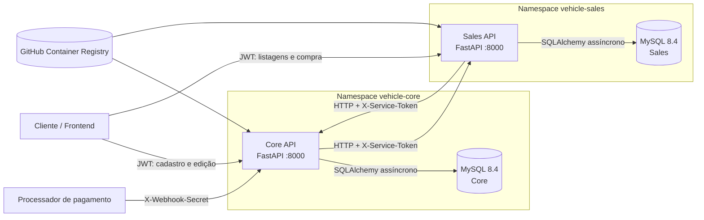
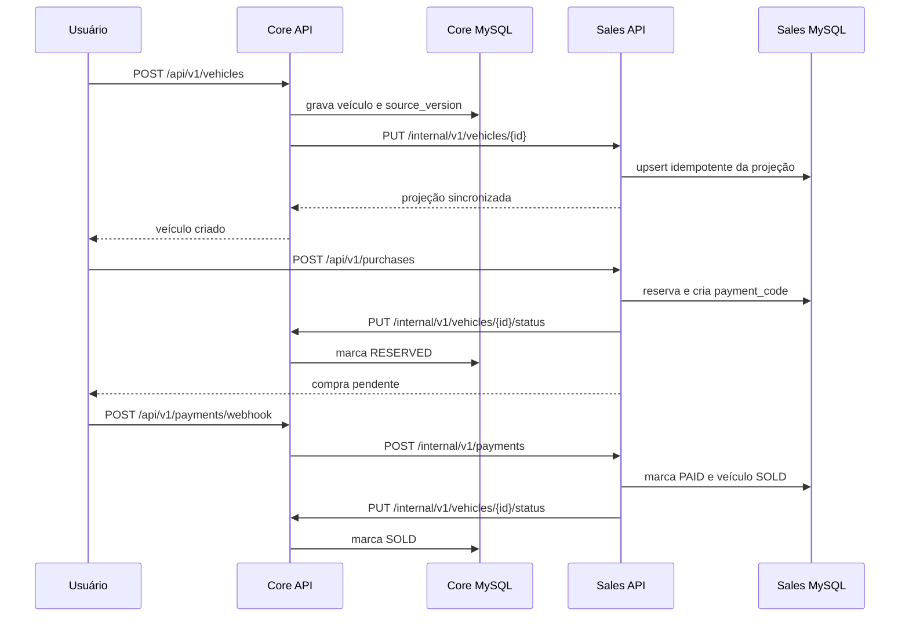

# Arquitetura da solução

## Visão geral

## Responsabilidades

### Core

- registra e autentica usuários com JWT e Argon2;
- mantém o cadastro canônico do veículo;
- recebe o webhook externo de pagamento;
- publica alterações do veículo para Sales;
- recebe de Sales mudanças de estado do catálogo.

### Sales

- mantém uma projeção local dos veículos vendáveis;
- lista disponíveis e vendidos por preço crescente;
- reserva um veículo e cria o código de pagamento;
- processa eventos de pagamento idempotentes;
- informa ao Core a mudança para `RESERVED`, `AVAILABLE` ou `SOLD`.

## Segregação de dados

O Core e o Sales usam instâncias MySQL, credenciais, volumes e redes diferentes. A aplicação Core não recebe a URL do banco Sales, e vice-versa. A única integração permitida entre domínios é HTTP.

No Compose:

- `core-data` é privada e contém somente Core, sua migração e `core-db`;
- `sales-data` é privada e contém somente Sales, sua migração e `sales-db`;
- `integration` contém apenas as duas APIs.

No Kubernetes, os domínios ficam em namespaces diferentes. NetworkPolicies descrevem a mesma intenção, mas sua aplicação depende de um CNI com suporte à política de rede; o Kind padrão pode exigir Calico ou Cilium para efetivamente bloqueá-la.

## Consistência entre serviços

Não há transação distribuída. Cada alteração tem versão de origem, identificadores idempotentes e estados explícitos de sincronização. Chamadas HTTP usam timeout; falhas devem poder ser repetidas sem duplicar compra ou pagamento.

## Implantação

Há dois caminhos mutuamente exclusivos:

1. manifests em `infra/kubernetes`, aplicados na ordem numérica;
2. Terraform em `infra/terraform`, que cria os mesmos objetos.

As imagens são publicadas no GHCR. Em uma entrega real, cada rollout deve usar tag imutável ou digest do commit aprovado. Os Jobs Alembic executam antes dos Deployments; os Deployments sobrescrevem o entrypoint da imagem para evitar que cada réplica tente migrar o banco novamente.

## Observabilidade operacional

- `/health/live`: processo ativo, sem depender de serviços remotos;
- `/health/ready`: prontidão da instância e de seu próprio banco;
- logs enviados para stdout/stderr;
- request ID deve ser propagado entre APIs;
- CPF, senhas, JWT, tokens e segredos de webhook não devem aparecer nos logs.

